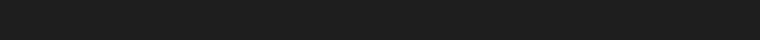

# progress-bar

An animated, step-by-step progress bar for Claude Code. When a request will take Claude more than a few actions, Claude announces its plan, and a bar of dots appears above the prompt: one dot per step, the current step drawn as four orange dots that dance, and a messenger dot that glides along a dotted thread to the next step when one finishes.



## What you see

- **One dot per step.** Steps still to come are grey and asleep. Finished steps are solid orange.
- **The current step dances.** Four orange dots, in the spirit of Claude's own working indicator. There are eight dances, and each task draws its own order, so step 2 never always looks the same.
- **A step finishes.** The four dots fold into one, which pulses once. A messenger dot leaves, lights the thread behind it and splits into four at the next step.
- **Plans change.** If Claude announces a new step while the messenger is travelling, it changes course without stopping. A skipped step lights up as the messenger passes it.
- **The work ends.** The last step folds in, the remaining steps light up, every dot pulses once together, and the bar fades away.
- **Details.** A `Details` button (or `/progress`) opens a panel with the request, the time spent, the step in progress, the number of actions, the context used, each step with its duration, and each subagent at work.

In a terminal session the bar is drawn in characters: a solid dot per finished step, the working indicator's glyphs on the current one, an empty dot for the rest.

## Install

At the prompt of a Claude Code terminal session:

```
/plugin install progress-bar --marketplace Gimzki/progress-bar
```

Answer `y` to add the marketplace, then choose a scope. Once installed at the user scope, the bar also shows in the Claude desktop app's Code tab.

## Options

| Option | Values | Default |
| --- | --- | --- |
| `language` | `en`, `fr` | `en` |

`language` sets the language of the bar and of the panel. The steps themselves are written by Claude, in your language.

## How it works

The mod registers one tool, `progress`, with `steps` (the plan, 2 to 8 short steps) and `step` (the number of the step that starts). A line added to the system prompt asks Claude to call it at the start of any request that takes more than three actions, and again at each new step. Subagents are ignored. The bar clears itself when the turn ends; an interruption clears it at once.

Everything the bar shows is derived from the history of the steps (which step, at what time) and the current time. The same history always gives the same picture, which is what keeps the animation continuous:

- On the desktop app, the bar is a surface module (`hooks/bar-client.tsx`) that the app keeps as it is when it rebuilds the band, and redraws only when a step changes, the work ends or the band changes width. Each new event is timed from the moment the display sees it.
- The drawing (`hooks/dots.ts`) is one SVG image. Positions are static CSS `calc()` values, so the bar is right at any width; everything that moves is SMIL, the one animation clock that starts at the same instant in every image. An animation already played is never written again: its end state becomes the image's starting state.

## Development

```
claude plugin validate .
claude plugin test .
```

The tests cover the plan, the timeline (step changes in flight, skipped steps, a finish during a flight, a step going back), the drawing (no animation already played at any instant, no image identical to a previous one, the messenger never at zero scale), the band on the terminal and the desktop surfaces in both languages, and the panel.

## Français

Une barre de progression animée, étape par étape, pour Claude Code. Quand une demande lui prendra plus de quelques actions, Claude annonce son plan, et une barre de points apparaît au-dessus du champ de saisie: un point par étape, l'étape en cours dessinée par quatre points orange qui dansent, et un point messager qui glisse sur un fil pointillé jusqu'à l'étape suivante quand une étape se termine. Chaque tâche tire son propre ordre parmi huit danses. Pour l'interface en français, réglez l'option `language` à `fr`.

## License

MIT. See [LICENSE](LICENSE).
